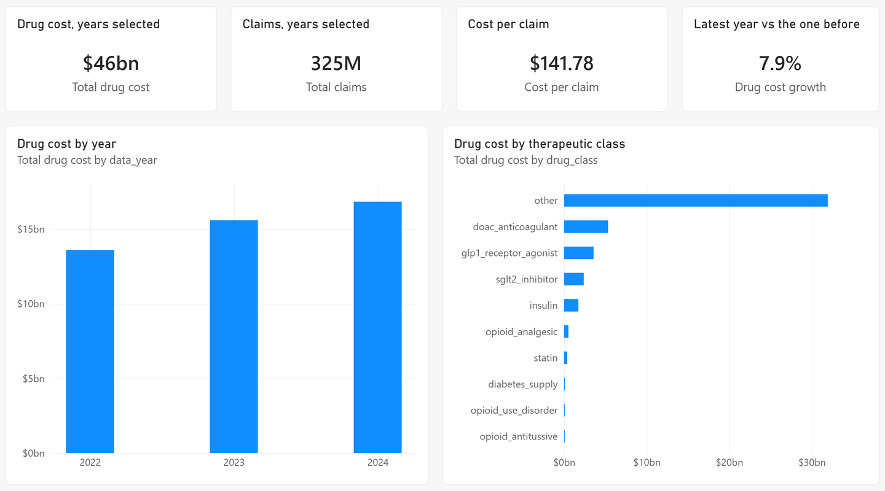
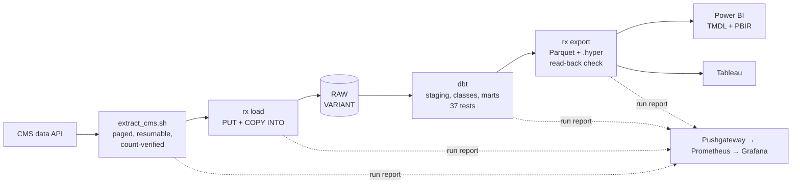

# Medicare Rx analytics

Florida Medicare Part D prescribing, 2022-2024: 5.9 million prescriber-drug records pulled from the CMS data API
by a resumable Bash extractor, landed in Snowflake as raw JSON, modelled and tested with dbt, and published to
Power BI and Tableau, with the run monitored in Prometheus and Grafana.



## Results (every number from a committed file)

| What | Result | Source |
|---|---|---|
| Extraction | **5,869,525 Florida rows and 14,536 national rows (1,179 pages) in 25 min, 0 retries**; every dataset-year's rows on disk equal the API's own count | [`reports/extract/`](reports/extract), [`run-environment.json`](reports/run-environment.json) |
| Load, build, export | **257 s end to end**: load 165 s (about 50 s a year), dbt 83 s, export 5 s, on a local Snowflake emulator | [`pipeline-run.json`](reports/pipeline-run.json) |
| On Snowflake (trial account, AWS us-east-2, X-Small warehouse) | The same run as the key-pair service user: **831 s end to end** (load 642 s, mostly uploading 3.2 GB of pages from a home connection; dbt 88 s; export 30 s), **49 of 49 dbt nodes pass**, every mart **equal to the emulator's** (row counts and 44 numeric column sums, within 2e-7), **0.13 credits** | [`reports/snowflake/`](reports/snowflake) |
| Data quality | **49 of 49 dbt nodes pass** (1 seed, 11 models, 37 tests) on the full data | [`dbt-build.json`](reports/dbt-build.json) |
| BI | Tableau extract **reads back equal** to all 6 marts (row counts and every numeric column's sum); the Power BI project opens and refreshes in Power BI Desktop | [`exports.json`](reports/exports.json), [screenshots](docs/img) |
| A bug the data found | Name patterns had put **apomorphine** (Parkinson's) in opioids, **Contrave and Relistor** in addiction treatment and **insulin syringes** in insulin; classes are now per product, follow CDC's opioid definitions, and 23 reviewed edge cases are pinned by a test | [ADR 0004](docs/adr/0004-drug-classes-per-product-from-reviewed-rules.md) |

The emulator timings are from one desktop (Intel i5-13600KF, WSL2 with 15.5 GB) against
[fakesnow](https://github.com/tekumara/fakesnow), which peaked at 9.3 GB of memory. The Snowflake row ran on a
trial account on 2026-10-18 ([DEPLOY.md](docs/DEPLOY.md)).

## What the data says (gross cost, before manufacturer rebates)

From [`reports/findings.json`](reports/findings.json), computed from the same exports the reports read:

- Florida Part D drug cost rose from **$13.61 billion in 2022 to $16.84 billion in 2024 (+23.7%)**, on 103.1M and
  113.6M claims; cost per claim from $132.04 to $148.25.
- **GLP-1 claims grew 174%** (483,851 to 1,324,004) and their cost 149% ($674M to $1.68B). In 2024 GLP-1s were 10.0%
  of Florida's Part D drug cost, second among the tracked classes to the DOAC anticoagulants (11.6%). Semaglutide led with 750,695 claims.
- Opioid analgesics fell from 4.18% to 3.74% of all claims; buprenorphine for opioid use disorder rose from
  0.020 to 0.022 claims per opioid analgesic claim.
- Brand-name spend above the cost of the same generic name was at most **$503M in 2024** (an upper bound: the
  generic name groups strengths and forms).

CMS publishes gross cost only; rebates are confidential ([data card](docs/DATA-CARD.md)).

## How it works



`scripts/run_pipeline.sh` runs the stages, times each, and always writes a run report and pushes metrics, even
when a stage fails. Details: [ARCHITECTURE.md](docs/ARCHITECTURE.md), [DATA-DICTIONARY.md](docs/DATA-DICTIONARY.md),
[RUNBOOK.md](docs/RUNBOOK.md), ADRs in [docs/adr](docs/adr).

## Try it (2 minutes, no account, no download)

The repository carries a small sample of real CMS records (25 Tampa prescribers plus the pinned edge cases).

```bash
make up            # emulator, Pushgateway, Prometheus, Grafana (Docker)
make demo-docker   # the whole pipeline on the sample; Grafana at http://localhost:3006
```

Without Docker: `make install`, then `make emulator` in one terminal and `make demo` in another. The full
three-year run is `make extract` (about 25 minutes, 3.2 GB) then `make pipeline`.

## Testing and CI

- **35 Python tests, 97% line coverage**, against an in-process emulator: loading, idempotent reloads, paths
  with spaces, input validation, export types, the Hyper read-back catching a wrong sum, metrics.
- **10 bats tests** for the Bash extractor (resume, retries, corrupt pages, unreachable API) and the orchestrator
  (stage order, failure reporting, exit codes), against a fake CMS API.
- **37 dbt tests** on every run, plus **5 alert rules with promtool tests**.
- CI runs all of that, the whole pipeline on the sample, the compose stack end to end (checks that Prometheus
  received the run), Terraform validate/tflint/trivy, the Power BI project against Microsoft's schemas and
  against a regenerated copy, gitleaks, pip-audit and an image scan.

## Infrastructure

`infra/terraform` creates the Snowflake side: an extra-small warehouse behind a 10-credit monthly resource
monitor, least-privilege roles (loader, transformer, reporter), and a key-pair service user, since Snowflake
service users cannot sign in with a password ([ADR 0006](docs/adr/0006-snowflake-least-privilege-with-terraform.md)).
Validated and scanned in CI, and applied to a Snowflake trial account on 2026-10-18 (31 resources).

## Limitations

- One Snowflake run so far, from a home connection: the load stage is mostly upload time, so it says little
  about Snowflake itself.
- Part D only, Florida prescribers only, rows with 11+ claims only (CMS suppression); costs are gross.
- Drug classes cover nine tracked classes by reviewed rules; new products need review each year.
- The Tableau workbook is not published yet (needs a Tableau Public account).

## How it was built

Four one-day sprints run as GitHub milestones, with issues, one pull request per sprint and a committed retro
each: [docs/sprints](docs/sprints). Research notes with sources: [RESEARCH.md](RESEARCH.md).

Data: Centers for Medicare & Medicaid Services, public use files. Code: MIT.
