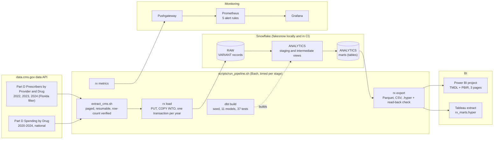

# Architecture

## Layers

| Layer | Where | Grain | Notes |
|---|---|---|---|
| Pages | `data/raw/<dataset>/<year>/page-*.json` | one API page (5,000 rows) | `manifest.json` records the API's row count and the rows on disk |
| Raw | `RAW.PARTD_PRESCRIBER_DRUG`, `RAW.PARTD_SPENDING_BY_DRUG` | one API row as VARIANT | plus `data_year`, `source_file`, `loaded_at` ([ADR 0001](adr/0001-raw-json-as-variant-schema-on-read-in-dbt.md)) |
| Staging | `stg_prescriber_drug`, `stg_spending_by_drug` (views) | typed rows; spending unpivoted to one row per year | prescriber names dropped here; blanks stay NULL (suppressed) |
| Intermediate | `int_drug_class`, `int_prescriber_drug` (views) | product class; row with class, brand flag, unit costs | classes from ordered, reviewed rules ([ADR 0004](adr/0004-drug-classes-per-product-from-reviewed-rules.md)) |
| Marts | `fct_prescriber_drug_year`, `dim_drug`, five `mart_*` tables | see [DATA-DICTIONARY.md](DATA-DICTIONARY.md) | what BI reads |

## Quality gates

- **Extraction:** rows on disk equal the API's own count for every dataset-year, or the run stops.
- **Load:** rows in raw equal rows copied, inside the transaction that replaced the year.
- **dbt (37 tests):** grain uniqueness on every model, not-null and range tests, CMS formats parse, every raw
  record reaches staging, the fact table keeps every staging row, mart totals equal staging totals, suppressed
  counts are never back-filled, and 23 pinned drug-class edge cases.
- **Export:** the Tableau extract reads back with the same row counts and column sums as the marts.
- **CI:** the whole pipeline runs on a committed sample of real CMS records; the Power BI project is regenerated
  and must equal the committed one; every BI JSON file validates against Microsoft's schemas.

## Where it runs

| | Local / CI | Production (designed, not applied) |
|---|---|---|
| Warehouse | fakesnow 0.11.22 in memory ([ADR 0002](adr/0002-fakesnow-as-the-local-snowflake.md)) | Snowflake, created by `infra/terraform` ([ADR 0006](adr/0006-snowflake-least-privilege-with-terraform.md)) |
| Sign-in | emulator defaults | RX_PIPELINE service user, key pair |
| Batch | `make pipeline` or `make pipeline-docker` | the pipeline image on a weekly schedule |
| Metrics | Pushgateway, Prometheus, Grafana in `docker compose` | the same, or `--textfile` for node_exporter |
| BI | Parquet + `.hyper` files | Power BI and Tableau connected to `ANALYTICS` as RX_REPORTER |
